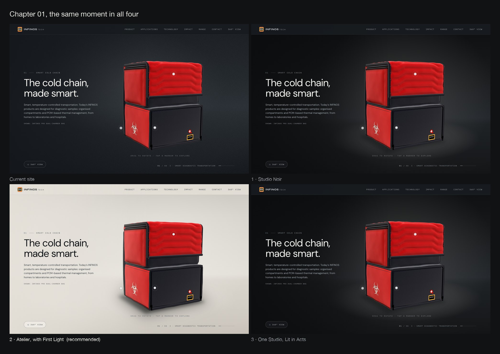
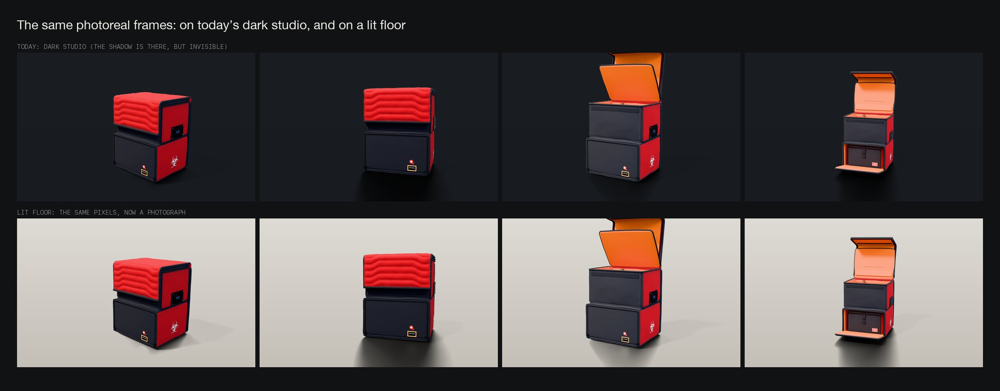
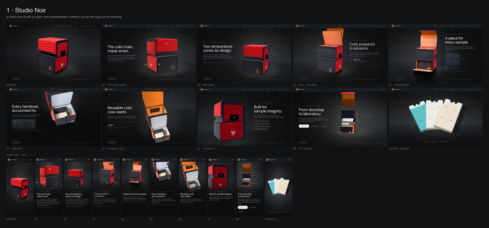
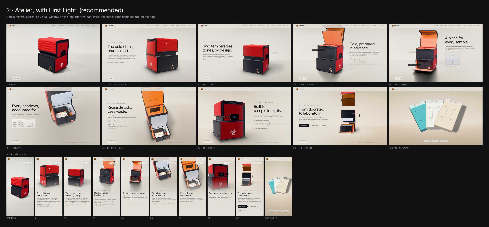
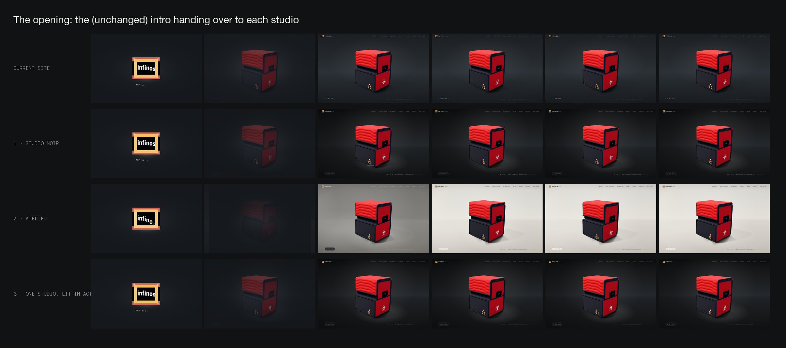
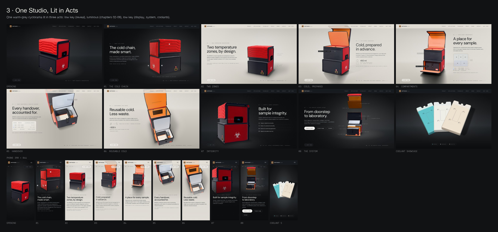
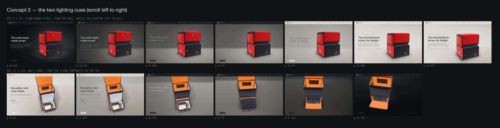
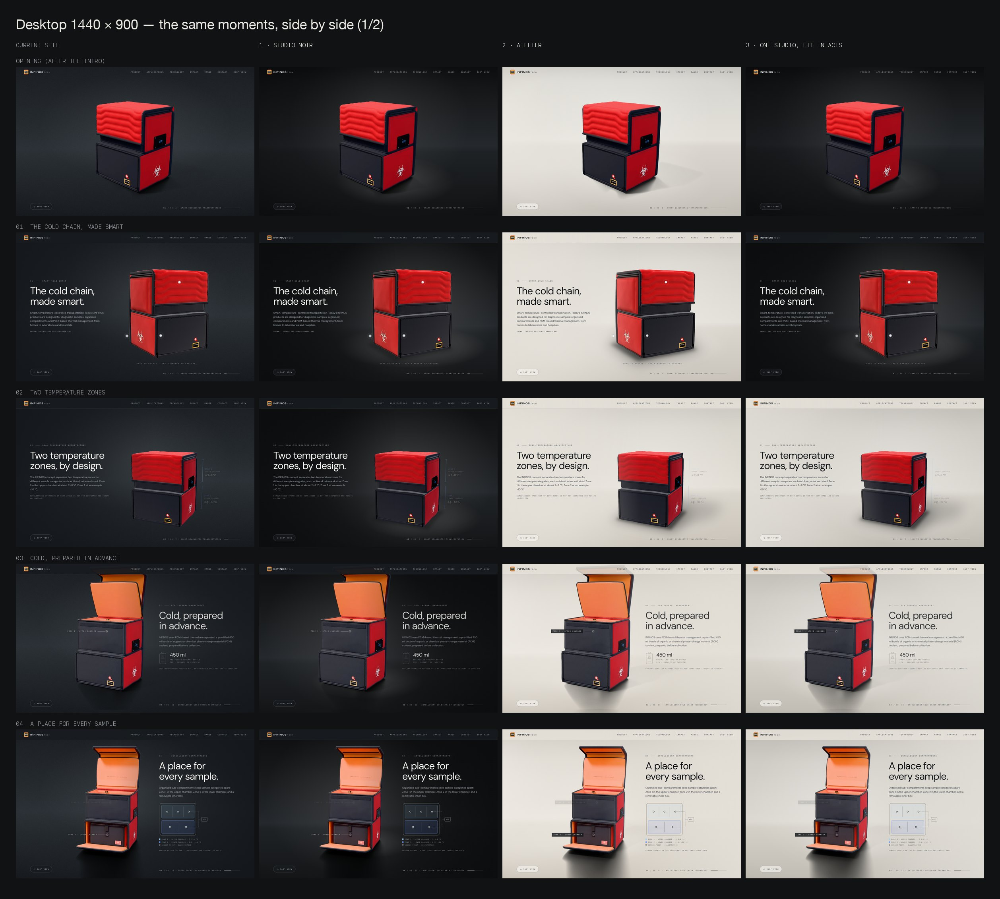
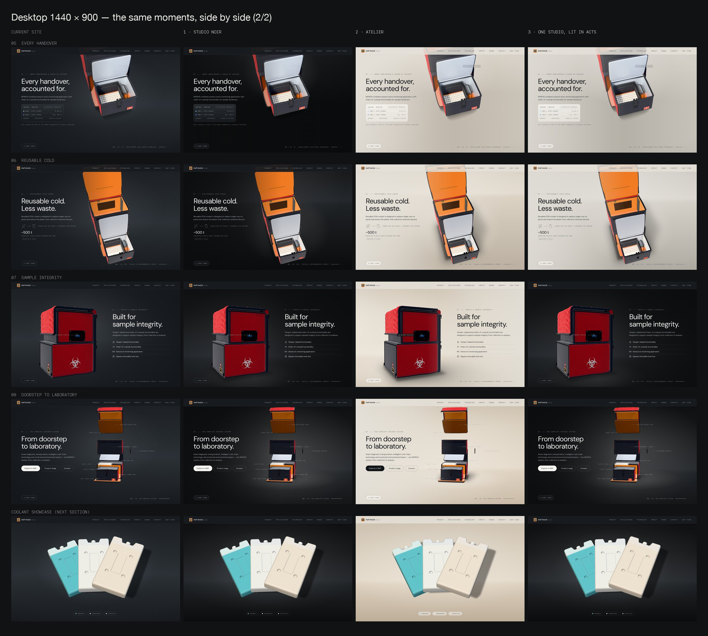
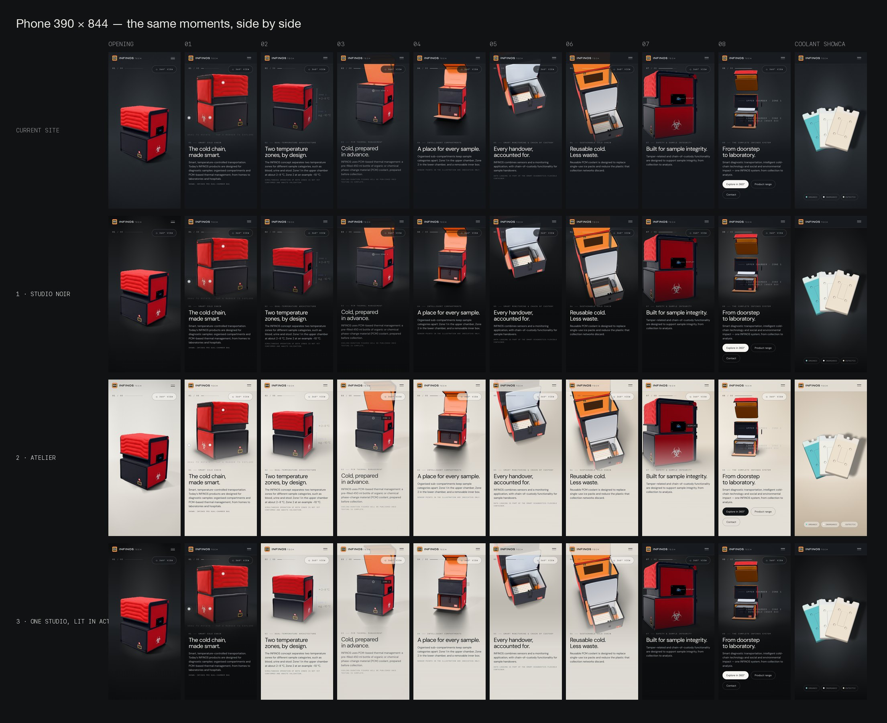

# INFINOS — Art direction proposal, round 2

Status: **awaiting approval.** Nothing has been implemented. The working website has not been modified during this
exploration: everything below was produced in the scratchpad, or injected temporarily into the production build in a
headless browser to take screenshots.

Boards and the presentation page: `docs/design/art-direction-r2/` (start with `index.html`).

## 0. How the mockups were made

- **Real build, real assets.** Every still is the production build at commit `1e34765`: the real model, the real
  photoreal frames, the real layout, copy, navigation and overlays. No stock imagery, no substitute product.
- **Environment from the real camera.** Each concept's environment was injected into the page behind the product. Its
  geometry comes from the site's own camera code (`cameraTrack.ts`, `composition.ts`, `filmLayout`, `projectToFilm`,
  bundled for the browser with their types stripped). The floor/wall cove, the floor light pool and the shadow are in
  true perspective at every scroll position, including the transitions.
- **Two mocked pieces, labelled as such:**
  - **Live-chapter contact shadow.** The live 3D scene's own contact shadow does not render today (§1). For the
    mockups, a soft shadow is drawn in 2D under the bag in the live chapters: ambient occlusion plus the key's cast
    shadow. In production it must be rendered by the live scene.
  - **Frame-edge extension.** The photoreal shadow is continued past the edge of its film, done here by intercepting
    the frame canvas's draw call. Production would do the same inside `ImageSequence`.
- **Sizes and limits.**
  - Desktop 1440×900; phone 390×844 at 2×.
  - Light levels are tuned by eye on one display.
  - Stills show positions inside chapters; the lighting cues are shown as filmstrips.

## 1. What studying the product and the site showed

1. **The product.** A soft-goods diagnostic carrier:
   - saturated red quilted fabric (horizontal wave quilting on the flap) and red side panels;
   - **black piping and frame that draw the silhouette**, and black front panels;
   - an interior of vivid orange liner, a white/silver inner box and a white sample rack, plus a small blue display and
     a yellow-framed label.

   On graphite the black outline dissolves and only the red survives. On a lit floor the outline, the quilting and the
   shadow all read.
2. **The photoreal frames are the best asset, and today they are invisible.** They are Cycles path-traced: a long, soft
   directional key shadow plus ambient occlusion on a shadow catcher. On the current dark backdrop that shadow
   disappears. On a lit floor it makes the bag look photographed (`frames-on-a-lit-floor.jpg`).

   
3. **The frames' edges are on screen.** The 16:10 film is smaller than the viewport in almost every frame position, at
   every desktop size tested (1280×720 to 1920×1080). The shadow reaches the film's bottom edge at up to 76 % density,
   and the right edge carries about 5 %. On a lit floor that would draw hard lines unless the shadow is continued past
   the edge. The mockups do exactly that, and the lines disappear.
4. **The live chapters have no visible contact shadow** (hero, exterior pass, interior, display, overview). This was
   verified on a neutral backdrop: the existing `ContactShadows` is mounted but renders nothing visible. The root cause
   is not yet diagnosed. Any concept needs it fixed. A lit floor also needs it to match the Cycles shadow at the three
   hand-overs (0.11, 0.31, 0.57).
5. **The camera language** spans a low hero (−7°), close passes, top-down interior views (−52…−58°), an eye-level display
   close-up (−2°) and a far overview. A cyclorama whose cove is projected from the camera works from all of them; when
   the camera looks down, the wall leaves the frame naturally.
6. **The rest of the site is already light.** After the coolant showcase, the sections run ivory, ivory, slate, white,
   graphite, slate, ivory, white, graphite. Only the story and the coolant showcase are dark (with grain). Type is DM
   Sans with IBM Plex Mono labels, accents are steel, and red is reserved for the product.
7. **The intro** (van, light line, logo build; preserved unchanged) ends on a dark frame, then the bag appears.
8. **The coolant packs** (teal, white, sand) pop on dark; on a pale floor the white and sand packs are defined by their
   shadows.
9. **Readability today:** body text sits at 7.1–7.4:1 on the median background behind each chapter's column (desktop)
   and 7.9–8.1:1 on phones.

## 2. Directions explored

| Direction | Verdict | Why |
| --- | --- | --- |
| Graphite architectural studio | **Developed: Concept 1** | The strongest version of a dark presentation. |
| Warm daylight atelier | **Developed: Concept 2** | Studying the frames made this the strongest candidate. |
| Hybrid light-to-dark | **Developed: Concept 3** | A lighting arc across the story. |
| Architectural light slot (round 1, B) | Dropped | A second bright subject in every chapter; reads as a neon tube up close. |
| Sculptural plinth / monolith | Dropped | Product-on-a-podium is a common template look. The frames' shadows lie on an infinite floor at y = 0, so a plinth edge would cut them in mid-air. |
| Cinematic industrial location (defocused hall or lab) | Dropped | Needs real location plates, which don't exist and can't be stock. Procedural plates read as fake bokeh, and location light would contradict the studio-lit renders. |
| Tonal red, or cold-blue "clinical" monochrome | Dropped | Red is reserved for the product. A blue cast fights the warm baked key and drifts toward sci-fi. |

---

## 3. Concept 1 — STUDIO NOIR

**1. Creative idea and identity.** A black-box studio at night: one photographer's softbox carves the bag out of
darkness. Light is the only design element. Intense, precise, nocturnal: the "Pro product" register.

**2. Environment and materials.** A seamless graphite cyclorama: a matte paper floor curving into the wall about 2.6 m
behind the bag, projected from the real camera. There is no horizon line, no props, no texture and no grain.

**3. Colour palette.**

- graphite `#0d0e0f`, rising to `#25282c` at the lit cove, falling to `#0b0c0d` on the floor near the lens;
- warm-neutral light (rgb 232 228 221);
- ivory text (`#f7f6f2` headlines, `#a7b0b8` body), steel accents;
- red only on the product.

**4. Lighting and shadow.** One overhead softbox from the front-left, the renders' own key. It lays a soft floor pool
where the shadow falls, plus a wash on the wall behind the upper body for separation. The edges fall to black, darkest
on the text side. Shadows read only inside the pool, so most of the frames' long soft shadow is lost.

**5. Product composition.** The existing composition track is unchanged. The brightest zone is under and behind the bag;
the text side is the darkest.

**6. Motion and scroll.** The camera moves through a physical set, and between chapters the light is re-set with eased
cues (pool size and level, wall wash). Nothing moves at rest. Optionally, in the live chapters the key could rake across
the quilting and return to the calibrated rig before each hand-over.

**7. The eight chapters.**

| Chapter | Treatment |
| --- | --- |
| Opening | First light only: a tight pool, the set black. |
| 01 | The hero light opens up. |
| 02 | Narrower, raking light. |
| 03–05 | Tight on the opening bag; the orange interior glows. |
| 06 | Top-down: floor only, a broad pool. |
| 07 | Low key; the display glows. |
| 08 | The widest light, the full studio; the exploded layers read as an exhibit. |
| Coolant showcase | The same cyclorama. |

**8. Mobile.** The product sits in the upper half, with the pool computed for the phone framing; the text block below
sits on near-black.

**9. Feasibility and performance.**

- Four or five static gradient layers inside `.stage`, moved only by transform and opacity from the shared frame loop.
- No new canvas, shader or dependency; no repaint while scrolling; nothing runs at rest; reduced motion behaves the same.
- Needs the live contact shadow fixed (§1.4).
- Effort: low.

**10. Problems with the existing frames.** Their best quality (the Cycles shadow) stays mostly hidden. The black piping
merges into the floor, so the silhouette dissolves at the base. Frame-edge lines can show inside the lit pool, so edge
extension is still advisable.

**Measured body-text contrast:** 8.1–8.7:1 desktop, 8.8:1 phone.

## 4. Concept 2 — ATELIER, with First Light

**1. Creative idea and identity.** The bag photographed in a daylight atelier: a pale mineral room with a tall window on
the left. Clarity, honesty and warmth — the way premium hardware and medical devices are shown in daylight. It joins
the story to the ivory editorial sections that already make up most of the site, so INFINOS reads as one brand from top
to bottom.

One cinematic cue opens it, **First Light**: the unchanged intro ends in darkness, the bag holds for a beat in a single
key light, then the studio lights come up around it.

**2. Environment and materials.** A limestone floor and plaster wall in one seamless cove, about 3.4 m behind the bag
and camera-projected. A soft window spill falls on the wall and a long, soft daylight patch on the floor, both from the
left. Smooth gradients, no grain.

**3. Colour palette.**

- plaster and limestone `#c9c7c2` → `#e3e0da` in the morning, warming slowly to `#cbbfae` → `#e4dacb` in late afternoon;
- graphite ink (`#111417` headlines, `#353c42` body), steel `#46586a`;
- navigation as ivory glass;
- red only on the product.

**4. Lighting and shadow.**

- Daylight from the left and front-left, agreeing with the renders' key.
- The frames' path-traced shadows appear at full strength (long, soft, falling back-right), so the bag is grounded in
  every frame.
- The live chapters get a real-time shadow matched to them.

**5. Product composition.** Unchanged. The pale field lets the black silhouette and the quilting read, and red is the
strongest colour on the page.

**6. Motion and scroll.**

- First Light happens once, after the intro: about a 0.7 s hold, then a 1.5 s rise. With reduced motion, the lights are
  simply up.
- After that, daylight warms very slowly through the chapters, from cool morning to warm late afternoon. There is no
  day/night cycle.
- Nothing moves at rest.

**7. The eight chapters.**

| Chapter | Treatment |
| --- | --- |
| Opening | First Light. |
| 01 | Morning light; a long, soft shadow. |
| 02 | Crisp side light; the piping and quilting read. |
| 03–05 | Midday. The opening interior has catalogue clarity, with the frames' shadows at full strength (edges extended). |
| 06 | An afternoon light table, seen from above; the white rack is framed by the dark box. |
| 07 | Late, slightly lower light; the display still reads. |
| 08 | Warm and even; the exploded layers float above their shadow, with callouts as graphite chips. |
| Coolant showcase | The same atelier: teal, white and sand packs on warm stone, defined by their shadows. The ivory sections then continue the palette. |

**8. Mobile.** The same lighting. The product sits in the upper half and the text below on a pale scrim.

**9. Feasibility and performance.**

- The environment works as in Concept 1: static layers, compositor-only. First Light is one opacity ramp.
- Plus:
  - (a) **Frame-edge extension** in the frame canvas: three extra draws per frame, using per-frame edge data
    precomputed once from the frame files.
  - (b) **A real-time soft directional shadow plus contact shadow** in the live scene, calibrated to the Cycles shadows
    at the three hand-overs. This adds one shadow-map pass, only when the live layer renders; a smaller map on phones.
  - (c) **Light variants of every overlay:** callouts become graphite chips; also figures, the monitoring panel,
    hotspots, navigation, buttons and the coolant pills.
  - (d) **Contrast tuning.**
- No new canvas, no new dependency.
- Effort: high.

**10. Problems with the existing frames.**

- The film edges are on screen in almost every frame position, so edge extension is mandatory (demonstrated in the
  mockups).
- The live and baked shadows must match at 0.11, 0.31 and 0.57, or the change will show on a pale floor.
- The renders were lit by a studio rig, so the window is placed on the key's side to keep the directions consistent.
- The renders have no warm bounce from the floor (minor).
- In top-down views the white rack sits on a pale floor; it is framed by the dark box, and holds up in the mockup.

**Measured body-text contrast** with the darkened ink (`#353c42`): 7.6–8.5:1 desktop, 8.0–8.4:1 phone.

## 5. Concept 3 — ONE STUDIO, LIT IN ACTS

**1. Creative idea and identity.** One warm-grey cyclorama whose tone is set only by light, the way a photographer turns
the same grey paper black or pale. The story is lit in three acts:

- **Act I, Reveal:** low key.
- **Act II, Understand** (chapters 02–06): the background banks come up to a luminous pale grey.
- **Act III, Trust** (07, 08 and the coolant showcase): low key again.

Theatrical; the most literally "film-like" of the three.

**2. Environment and materials.** The same cyclorama as Concepts 1 and 2, in two light states of one set.

**3. Colour palette.** Graphite (`#0d0e0f` … `#25282c`) ↔ warm pale grey (`#bebbb5` … `#dcd9d3`). Ivory text in the
dark acts, graphite ink in Act II, steel accents.

**4. Lighting and shadow.** The key is front-left throughout, and the background banks come up and go down.

- Shadows: full strength in Act II; inside the pool in Acts I and III.
- Cue up: the floor banks rise first, then the wall.
- Cue down: the wall dims first, then the floor contracts to the key.

**5. Product composition.** Unchanged.

**6. Motion and scroll.** The two cues are scroll-linked (about 0.17–0.205 and 0.69–0.72). Both sit inside live
chapters while the chapter text is out, so no photoreal frame is on screen and no text is visible during a light change.
Nothing moves at rest.

**7. The eight chapters.**

| Chapter | Treatment |
| --- | --- |
| Opening and 01 | Act I, dark (as Noir). |
| Cue 1 | The lights come up. |
| 02–06 | Act II (as Atelier, in neutral grey). |
| Cue 2 | The lights go down. |
| 07 | Act III, low key; the display glows. |
| 08 | The exploded system as an exhibit in the dark. |
| Coolant showcase | Dark, then the ivory sections: the story mirrors the site's own dark/light rhythm. |

**8. Mobile.** The same acts and cue positions. The text tone flips with the act, and the scrim below follows.

**9. Feasibility and performance.**

- Everything in Concepts 1 and 2, with the light-studio work limited to 02–06.
- Plus a tone system for every overlay and the navigation, flipping only while the text is out.
- The two light states are prepared once and crossfaded by opacity (compositor-only).
- Effort: high, with the heaviest QA load: two tones × every overlay × both scroll directions.

**10. Problems with the existing frames.** As in Atelier for the open sequence and the 0.31 / 0.57 hand-overs (both in
Act II); as in Noir for the reveal frames.

**Measured body-text contrast:** 7.0–8.5:1 desktop, 7.7–8.8:1 phone.

---

## 6. Critical evaluation

● strong · ◐ adequate · ○ weak (my judgement after studying the mockups at full size)

| Requirement | 1 Noir | 2 Atelier | 3 Acts |
| --- | --- | --- | --- |
| Product as the star | ◐ red glows, black edges dissolve | ● every material reads | ● Act II · ◐ Acts I and III |
| Realistic grounding and contact shadows | ○ only inside the pool | ● the frames' own shadows | ● Act II · ◐ Acts I and III |
| Convincing studio illumination | ◐ | ● | ● |
| Text readability (body, desktop) | ● 8.1–8.7:1 | ● 7.6–8.5:1 | ● 7.0–8.5:1 |
| Sophisticated depth | ◐ | ● | ● |
| Restrained, purposeful animation | ● | ● one cue | ◐ two cues that must be perfect |
| Beautiful static compositions | ◐ | ● | ● / ◐ |
| Desktop and mobile consistency | ● | ● | ● |
| First impression (opening + 01) | ◐ | ● | ◐ the hero stays dark |
| Continuity: intro → story → coolant → sections | ◐ dark story, light site | ● First Light, then one palette | ● mirrors the site's rhythm |
| "Not a generic dark website" | ○ | ● | ◐ |
| Risk | low | medium | medium-high |
| Effort | low | high | high+ |

## 7. Recommendation: Concept 2, ATELIER with First Light

Why it is better:

1. **It makes the bag look photographed in every chapter.** The frames' own path-traced shadows become its grounding.
   They are the site's best asset and are invisible today. The black structure and quilting read, and the red is at
   its richest.
2. **The first impression is the strongest frame.** The light hero comes first, and the cinematic moment is kept: the
   dark intro flows into a lighting reveal.
3. **One identity, end to end.** Story → coolant → ivory editorial sections, with graphite remaining the brand's accent
   (ink, navigation, slate and graphite sections).
4. **Restraint.** One cue and a slow daylight arc; no theme switching mid-story.
5. **Achievable.** The mockups show that the two problems specific to a light studio are tractable: edge extension
   removes the frame lines, and the light overlays measured 7.6:1 or better for body text. The live shadow is the main engineering
   task, and it is needed in any concept.

**Why not Acts.** It has the richest drama, but it puts the weaker dark look on the hero — the most important impression
— and it needs two tone flips, forwards and backwards, across every overlay. Its gains (the display glow, the dark
exhibit) are smaller than its costs. Its best idea, a lighting arc, survives in Atelier as First Light plus the daylight
arc.

**Why not Noir.** It is the easiest, but it leaves the bag without real grounding, hides the frames' shadows, dissolves
the black silhouette and keeps the dark-website look the brief wants to leave behind.

**A change of view, stated plainly.** In round 1 I recommended the graphite studio. Measuring the frames' alpha, seeing
them on a lit floor, and studying the rest of the site changed that.

## 8. If approved: order of work, with a checkpoint

1. **Foundations first.**
   - Fix the live contact shadow.
   - Add a soft directional shadow calibrated to the Cycles shadow.
   - Add frame-edge extension.
   - Verify all of it at the three hand-overs on the pale floor.
   - **Checkpoint:** if the live/baked shadow match is not convincing there, stop and report before going further. A
     darker floor (Acts or Noir) hides a mismatch better.
2. The environment layers, the daylight plan and First Light.
3. Light variants of the overlays, navigation and coolant UI; body text at 7:1 or better.
4. The coolant showcase backdrop at the same atelier.
5. **Validation:**
   - the existing suites: intro timing, chapter fit at 5 sizes, coolant, viewer, reduced motion, no-WebGL, WebKit
     harness;
   - text contrast per chapter;
   - before/after stills at 5 sizes;
   - idle cadence and scroll frame timing (throttle-gated);
   - no Safari or real-device claims unless those are actually tested.

**Preserved untouched in every concept:** the intro and logo animation (First Light begins after it), product geometry
and materials, the camera and scroll architecture, the story logic and exploded view, the coolant showcase's behaviour,
the 360° viewer, gallery and consent restrictions, navigation and content. No new WebGL canvas, no new dependency.
